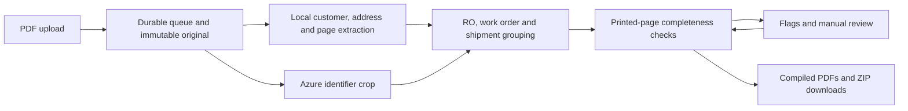

# OCR Workspace

Upload a shuffled PDF containing several rental orders. The workspace reads its pages, groups work orders and shipments under the correct rental order (RO), identifies missing or conflicting pages, and compiles complete work orders for download.

The tracker starts empty. Uploaded documents create its rows; Excel files and sample manifests do not supply order data.

## Start locally

Use Python 3.12 or 3.13. Raster scan extraction currently requires macOS Vision and the Swift command-line tools. Azure Document Intelligence reads the identifier crop.

```sh
uv sync --locked --all-groups
# Create .env only if it does not already exist:
test -f .env || cp .env.example .env
```

Set these values in `.env` before uploading:

```dotenv
AZURE_DOC_INTEL_ENDPOINT=https://YOUR-RESOURCE.cognitiveservices.azure.com/
AZURE_DOC_INTEL_KEY=YOUR-KEY
```

Prepare the workspace and current samples, then start the app:

```sh
uv run --locked python scripts/prepare_workspace.py
uv run --locked python scripts/create_rental_hierarchy_sample.py --all-batches
sh scripts/run_web.sh
```

Open **http://127.0.0.1:8700/#/overview**. Initialization upgrades existing data without clearing it. Generating samples replaces only named sample templates and backs up their previous versions. Uploaded originals, orders, reviews and download history stay intact.

Processing an uploaded PDF makes Azure calls and can incur charges. Creating samples and browsing existing results make no Azure calls. The current local app accepts generated synthetic PDFs whose checksums are allowed by the manifest.

## Order structure

The document layout and review workflow follow this reading order:

```text
RO — rental order / rental agreement
  Order number (OD)
  Shipment number (SO)
  Customer
  Address and delivery location
  Document type, copy and printed page X/Y
```

A customer can have several ROs. Each RO can group several OD orders and SO shipments, and multiple orders can share a shipment. The current tickets print only these three identifier types: OD, RO and SO. **A shipment number is not a customer order or work-order number.** Rental agreement and rental order are the same RO field; older `RA-…` labels normalize to `RO-…` while the original page reading is retained.

## Try the current dataset

Choose a PDF from `Scans/incomming_scan/` and drop it onto Overview or OCR activity, or use **Choose PDF**. The spelling `incomming_scan` is intentional for workspace compatibility.

| Files | Contents |
| --- | --- |
| `batch_01_8_orders.pdf` through `batch_08_8_orders.pdf` | Eight PDFs, each containing 2 ROs, 8 OD orders, 4 shared SO shipments and all 48 shuffled pages. |
| `rental_orders_RO_OD_SO_shuffled.pdf` | An identical alias of batch 1. Uploading both does not duplicate its pages. |

Across the eight batches there are **64 work orders under 16 ROs and 32 shipments**. Each work order expects six printed pages. Every batch includes:

| Case | Expected result | Action |
| --- | --- | --- |
| Six orders with normally positioned identifiers | Approved and ready for download | Download their compiled PDFs or scan ZIP. |
| One order with the OD line on printed page 1 below the OCR zone | All six images exist, but page 1 needs review | Inspect the visible OD, RO, SO and customer/address in Flags and link the image. |
| One order with the OD line on printed page 6 below the OCR zone | All six images exist, but page 6 needs review | Inspect and approve the correct original image. |

No page or identifier is deleted or replaced with a fake number. The fixed crop cannot read the shifted OD, while local full-page extraction retains it for review. A readable RO or SO alone does not automatically verify an OD page. Across eight batches, 384 pages are present: 48 orders should complete automatically and 16 need one page reviewed. These are expected results, not preloaded statuses; actual provider readings determine the outcome.

Generating samples does not submit them or preload rows. Previously uploaded legacy batches retain their original identifiers and test cases; refreshing templates does not rewrite that history.

## Use the workspace

| Tab | Purpose |
| --- | --- |
| **Overview** | Upload PDFs and see flat Approved / In review order rows, with downloads for approved orders. |
| **Dataset** | Search the document-derived tracker by RO, work order, shipment, customer or address. Check completeness and download marks. |
| **OCR activity** | Follow the current PDF's actual page total and processing progress. Download its completed work orders together. |
| **Flags** | Inspect incomplete orders, unmatched images and field conflicts; repair assignments or upload missing pages. |
| **Ingestion history** | See document-processing runs. |

### Review and repair

Open an incomplete work order in Flags and choose **Fix pages**. The target RO, work order, shipment, customer and address identify what you are completing.

- **Possible matches** are unassigned images without a known conflicting order or page field. They still require your review.
- **Different images** have conflicting customer, address, RO, work-order or printed-page details. They remain available for inspection and for their correct order; they are not deleted or marked complete.
- **No matching image** means available images cannot fill the selected printed slot. Upload the missing page instead of linking an unrelated image.

Selecting an image changes its preview and comparison only, preserving the tab, scroll and keyboard focus. The comparison separates target values from image values. Known identity/page conflicts block linking on the server and in the UI. Shipment differences or unreadable identity require explicit acknowledgment after inspection.

The link action names both source image and destination work order/page. A separate approval record preserves the decision without changing the source PDF or original OCR result. An order becomes ready only when every expected printed page is accounted for without duplicates. One complete order can be downloaded while others still need attention.

### Download once

Before downloading the scan ZIP, its card shows orders detected in this scan, ready orders, orders not ready, and printed pages still unresolved. Only ready orders enter the ZIP. Counts update after repairs and exclude older scans; saved scan results remain available after restarting the app.

PDF and ZIP downloads mark included work orders **Downloaded**. The mark persists after refresh or restart, with a separate **Download again** action. Inline previews do not count. Changed source pages create a new downloadable version; earlier receipts remain in history. A receipt records a file served by the app, not confirmation that a browser saved it to disk.

## Processing pipeline



Uploads are limited to 50 MB per PDF. A completed upload triggers processing immediately; there is no two-second folder polling. Durable queue markers recover pending submissions after restart. Copying a sample into the folder does not submit it.

Each previously unattempted page makes one Azure request. The parser retains RO, TK/work-order, shipment and customer-order namespaces separately from that response. OD must be read from the provider crop and agree with local evidence before a new OD page passes. Full-page customer/address extraction stays local. Unmatched pages retain their extracted fields. Failed provider attempts remain visible and are not silently retried.

## Files and persistence

| Path | Purpose |
| --- | --- |
| `Scans/incomming_scan/` | Selectable samples and incoming uploads. |
| `Scans/processed/<sha256>/` | Preserved original uploads referenced by database pages. |
| `Scans/flag_order/` | Copies and page-status reports for scans needing attention. |
| `Scans/output/` | Checked, compiled ticket PDFs. |
| `Scans/manifest.json` | Synthetic-file allowlist and sample case descriptions; not the source of tracker rows. |
| `demo_runtime/workspace.sqlite` | Orders, pages, attempts, RO links, manual approvals and versioned download receipts. |

`ADK_Agentic/storage.py` owns the schema and startup migrations. PostgreSQL migration references are in `database/`; the local app uses SQLite. Generated data, source documents, runtime databases and credentials are excluded from Git.

For older registered scans, `scripts/extract_page_details.py` adds local details and `scripts/link_existing_rental_numbers.py` links printed agreement labels to the RO field. Neither makes Azure calls or reassigns pages. `scripts/rebuild_scan_dataset.py` is an explicit destructive reset tool, not part of normal startup or sample refresh.

## Checks and contribution workflow

Work on a feature branch. Before requesting review:

```sh
uv run --locked ruff check ADK_Agentic scripts tests
uv run --locked pytest -q
cd web
npm ci
npm run check
npm test
```

Tests use generated PDFs and mocked Azure responses. UI tests cover uploads, stable selection, comparisons, missing-page recovery and download marks. Optional PostgreSQL tests require a disposable `TEST_DATABASE_URL`. Tests do not establish live Azure connectivity or production readiness.

## Current scope and documentation

This is a localhost synthetic-document workspace. Raster extraction uses macOS Vision; unfamiliar layouts need field mappings and validation. Production authentication, unrestricted private-document ingestion and distributed worker coordination are outside the current product UI.

The Azure crop is the right half of the top quarter of each page. Keep customer details and signatures outside it when changing templates; the current samples do so. Signature status reports printed evidence or PDF fields and does not authenticate signatures.

- [Product UI and operations](docs/product-ui.md)
- [Data pipeline and migrations](docs/data-pipeline.md)
- [Configuration reference](docs/configuration.md)
- [Architecture](docs/architecture.md)
- [Legacy walkthroughs](docs/walkthroughs.md)
- [Historical Azure validation evidence](docs/ocr-validation-results.md)

The legacy Streamlit interface and workbook generators are separate compatibility tools. Their older recordings and validation results do not describe the current document-driven OD/RO/SO workflow.
