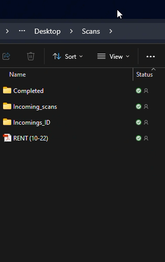
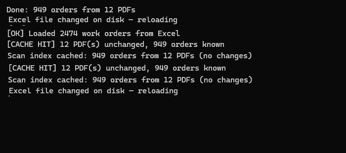

# Optical Character Recognition (OCR)

A document operations workspace for tracking work orders, delivery details, ticket pages, and Azure OCR verification. A custom web UI talks to a FastAPI backend over the relational data pipeline.

[See the workflow clips](#video-clips) for scan intake and incremental indexing.

## Run the product UI

The local synthetic workspace needs no API key to browse existing records. From an activated Python environment:

```sh
python3 -m pip install -r requirements.txt
# Only if generated datasets are not already present:
python3 scripts/create_demo_data.py --count 100 --seed 42 --output demo_data
python3 scripts/prepare_demo.py
sh scripts/run_web.sh
```

Open **http://127.0.0.1:8700**. Select **Azure-verified batches** to inspect the 20 live-verified tickets, or **Full demo dataset** for the complete fixture set. The validated dataset appears after running `scripts/validate_ocr.py` with your own Azure configuration.

The **Order Tracker** has readable rows, search, status/OCR filters, pagination, and CSV export. Select a work order to see delivery location, billing address, equipment, page previews, and expected/extracted OCR identifiers. Ticket downloads include only that order's pages, even when the source PDF contains a full batch. Reviews are saved to SQL.

Left navigation provides Overview, Order Tracker, Documents, OCR activity, Review queue, and Ingestion history. This interface does not use Streamlit and makes no Azure calls while browsing. See the [product UI guide](docs/product-ui.md) and [database/ETL guide](docs/data-pipeline.md).

## Legacy signed-in interface

The original Streamlit interface remains available for compatibility. Its dependencies and Microsoft sign-in settings are separate from the new local product UI.

```sh
python3 -m venv .venv
source .venv/bin/activate
python -m pip install -r requirements.txt -r requirements-dev.txt
cp .env.example .env
python scripts/create_sample_data.py
# Fill .env with your own Azure and Entra settings.
streamlit run ADK_Agentic/streamlit_app.py
```

Register `http://localhost:8501` as a web redirect URI in Entra, create a client secret, and supply the tenant ID, client ID, and secret. Authentication remains mandatory in the live app. The separate synthetic preview requires no sign-in. Key Vault is optional and requires `AZURE_KEY_VAULT_URL` plus appropriate Azure identity access.

The sample script generates a fictional workbook and PDF. Replace `EXCEL_PATH` and place your own ticket PDFs in `Scans/incoming_scans/` when ready. Workbook columns include `Order_ID`, `SO`, `Customer_name`, `Ship_to`, and `Status`; monthly sheets are combined. Optional tracker columns enable additional dashboard views.

## Live OCR validation

The two new synthetic batches passed live Azure verification: **120/120 pages matched their expected shipment IDs**, across 20 tickets, with no mismatches or provider errors. See the [method, evidence, and limitations](docs/ocr-validation-results.md).

## Full demo dataset

Generate 100 fictional ticket packets with 6, 9, or 12 pages each, including equipment, demo terms, and acknowledgement papers:

```sh
python scripts/create_demo_data.py --count 100 --seed 42 --output demo_data
```

The generator produces scanned-style PDFs, a matching Excel/CSV tracker, and a reproducibility manifest. It uses entirely fictional data, leaves the reference PDF untouched, and makes no Azure calls. See the [demo-data guide](docs/demo-data.md) for options and dashboard setup.

## Data and privacy

The default OCR crop sends the top-right half of the top quarter of each page to Azure. A geometric crop cannot guarantee that personal information is absent: inspect your document layout first. The OCR utility also exposes an uncropped option. Local workbooks, PDFs, caches, outputs, credentials, and virtual environments are excluded from Git. Use trusted local cache files only: the Excel cache uses Python pickle.

The product UI is a localhost synthetic-data workspace. The legacy interface retains Microsoft sign-in. Production private-data access is outside the new UI's current scope. Azure processing is invoked separately and can incur charges.

## Dependencies and checks

Primary runtime dependencies are in `requirements.txt` and `requirements-web.txt`; the SQL layer uses `requirements-data.txt`. The optional legacy Streamlit stack remains in `ADK_Agentic/requirements.txt`. Development dependencies are in `requirements-dev.txt`. Frontend DOM tests use the locked npm development dependencies in `web/`; the UI itself has no browser runtime framework or build step.

```sh
python3 -m pytest -q
cd web
npm ci
npm test
```

Tests mock Azure OCR; they do not prove live sign-in or Azure connectivity. See `PRP.md` for audit findings and remaining publication checks.

## Architecture and documentation

The primary interface is a static HTML/CSS/JavaScript client served by FastAPI. Its API reads the SQL order/page model and keeps expected associations separate from actual OCR evidence. Azure processing and tracker ETL are explicit backend operations. See the [product architecture](docs/product-ui.md) and [data flow](docs/architecture.md).

Start with the [documentation guide](docs/README.md), then use the [configuration reference](docs/configuration.md), [operations guide](docs/operations.md), and [proposed architecture decision](docs/decisions/0001-modular-monolith.md). The guides identify implemented features and remaining migration work.

Use the [Google Doc architecture workspace](https://docs.google.com/document/d/19lhy8-3sdm3E9ZSVoxvQ6Cty-0Tm62eW5EJPxWn24YQ/edit?usp=drivesdk) for design discussion. Versioned repository guides remain the source of truth; synchronization is manual. The document retains its existing Drive access settings.

## Video clips

Short, silent clips from the supplied recordings demonstrate scan intake and incremental indexing. These recordings predate the public copy; they show workflow behavior, not current performance benchmarks.

### Scan intake

Place scanned PDFs in the incoming scans directory. The app checks for new or changed PDFs during dashboard reruns.



[Open scan-intake clip](docs/media/scan-intake.gif) · 11 seconds · account sidebar and desktop cropped out.

### Incremental indexing

Unchanged PDFs reuse their cached associations. New or changed PDFs trigger OCR; the log reports cache hits and the work that remains.



[Open indexing clip](docs/media/incremental-indexing.gif) · 18 seconds · operational identifiers and filenames concealed.

Both clips are silent animated GIFs that play directly in the README. The original videos remain local. See [clip provenance and editing notes](docs/walkthroughs.md).
