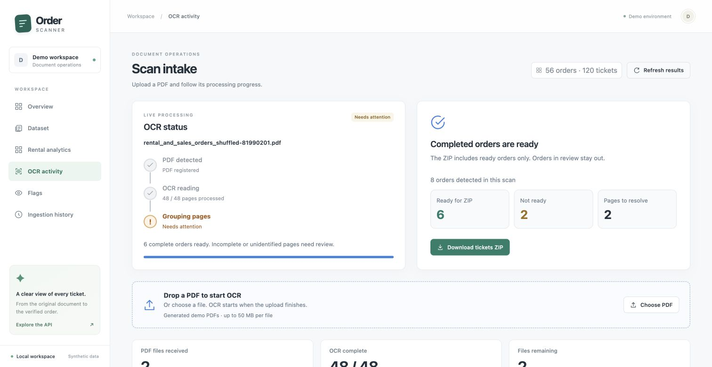
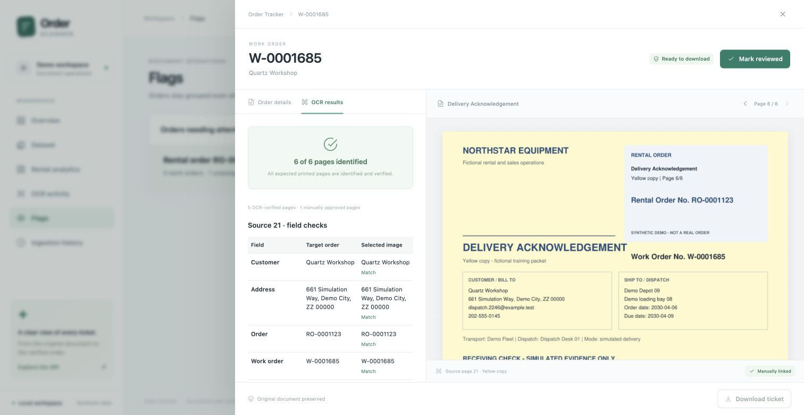
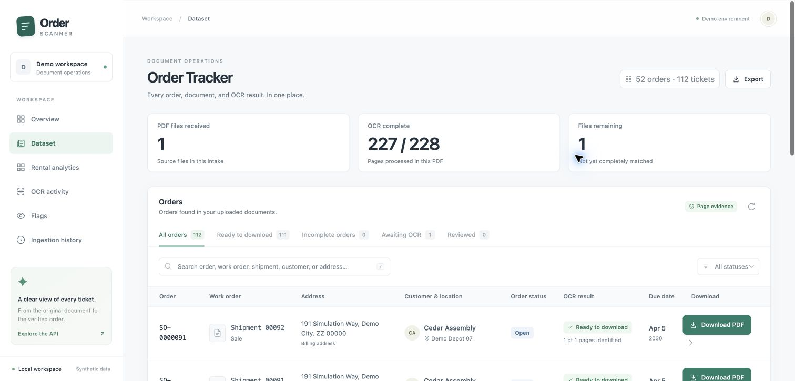
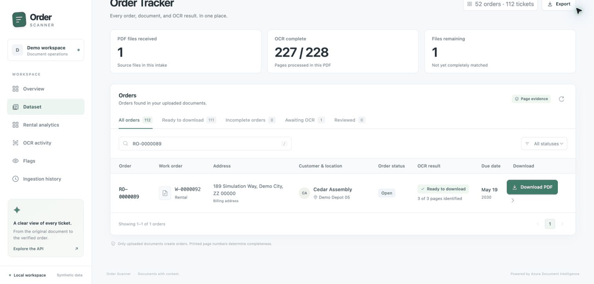
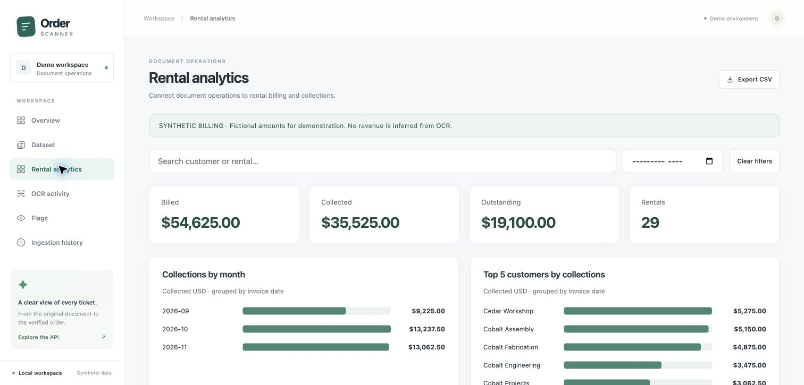
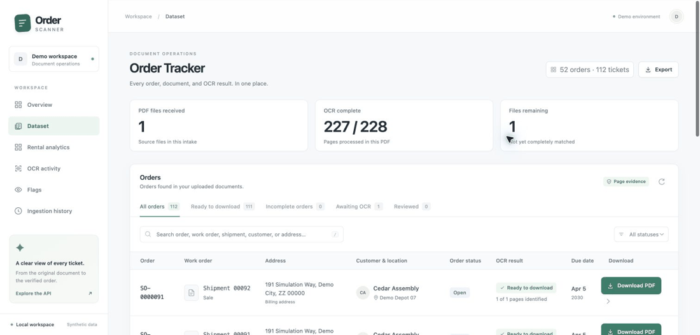
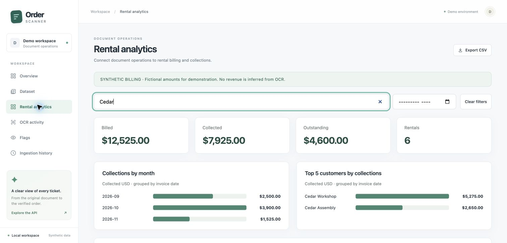
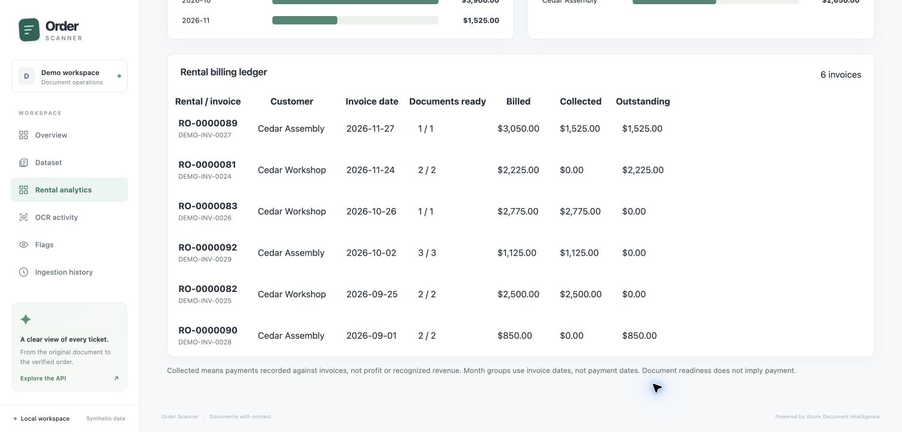

<h1> Order Scanner</h1>


**A document tracker for rental and sales operations, with OCR review and rental billing analytics.**

Turn shuffled scans into verified work-order and shipment packets. Track missing pages, compare flagged images with their target order, preserve human review decisions, and see rental billing and collections by customer.

**Original operational impact:** processing approximately **150 tickets a day** went from around **5 hours to 10 minutes**, including manual review—about **4 hours 50 minutes saved daily**. These are my observations from the original application, not a benchmark of this public demo.

## Watch OCR find a problem—and repair it


[Watch the 47-second OCR and repair video](docs/media/order-scanner/ocr-flag-repair-live.mp4)

In this recorded run, Azure processed **48 shuffled pages across 8 documents**:

1. **OCR found two exceptions:** 6 documents were ready and 2 needed review.
2. **Flags identified the missing slot:** work order **W-0001685**, under rental order **RO-0001123**, had 5 of 6 pages identified.
3. **The candidate image matched:** source image **21** agreed on customer, address, rental order, work order, and printed page **6/6**.
4. **A manual link completed the order:** the scan finished this repair with **7 ready documents and 1 remaining flag**.

| Before repair | After linking the matching image |
| --- | --- |
|  |  |

*Recorded November 20, 2026 using synthetic documents and real Azure OCR. Processing footage runs at 8× speed and review at 1.25×; gaps between capture segments are removed. Recording begins during processing. The PDF was submitted through the local intake API after the browser file picker stalled. The repair adds a separate approval record and preserves the original OCR result and source PDF. The other flagged work order remains unresolved.*

## From source document to verified packet

| Step | What the workspace does |
| --- | --- |
| **Upload** | Accept a generated demo PDF through Overview or OCR activity and preserve the original scan. |
| **Process** | Extract identifiers, match pages to work orders or shipments, and stream live progress. |
| **Review** | Group exceptions under their parent order. Compare candidate images and link compatible pages to their missing printed-page slots. |
| **Download** | Compile ready documents as individual PDFs or collect the ready documents from a scan in a ZIP. Record download history. |
| **Analyze** | Join explicit rental invoice and collection amounts to the document-derived rental orders. |

One complete document can be downloaded while another still needs review. Known identity or printed-page conflicts block linking; completeness requires every expected printed-page slot without duplicates.

### Orders keep their document relationships

```text
Rental order (RO-)                 Sales order (SO-)
 ├─ Work order (W-)                  ├─ Shipment
 └─ Work order (W-)                  └─ Shipment
```

Rental and sales orders share one order count. Work orders and shipments have their own identifiers. The tracker shows one row per work order or shipment, with its parent order, customer, address, page readiness, and download state. See [order numbering](docs/demo-workflow.md#order-numbering).



### Inspect the original pages

Open a work order to view its delivery ticket, rental agreement and delivery acknowledgement beside the order details and page-level OCR evidence.



[Watch the document viewer video](docs/media/order-scanner/document-tracker-live.mp4)

## Rental analytics

Connect document operations with rental billing and collections:

- **Billed, collected and outstanding** amounts in USD, plus a distinct rental count.
- **Invoice table** with rental order, customer, invoice date, amounts and work-order readiness.
- **Collections by invoice month** and **top five customers by collections**.
- **Customer or rental search**, **invoice-month filtering**, and **CSV export** of the filtered records.





[Watch the rental analytics video](docs/media/order-scanner/rental-analytics-live.mp4)

| Filter by customer | Inspect rental invoices |
| --- | --- |
|  |  |

Amounts come from an **explicit billing ledger**; OCR does not infer money earned. Unique invoice IDs and integer cents prevent duplicate invoice counting across work orders and rounding drift. Collected amounts are recorded collections against invoices, not profit or recognized revenue. Monthly charts group collections by **invoice date**, not payment date. The demo payments are fictional and labeled in the interface.

See [billing setup, CSV format and limitations](docs/rental-analytics.md).

## Six views, one workspace

| View | Purpose |
| --- | --- |
| **Overview** | Upload scans and see approved documents and documents in review. |
| **Dataset** | Search parent orders, work orders, shipments, customers and addresses; inspect pages and download ready packets. |
| **Rental analytics** | Explore rental invoices, collections, outstanding amounts and charts. |
| **OCR activity** | Follow live page processing and scan-specific ZIP readiness. |
| **Flags** | Compare unassigned images, resolve missing page slots and retain review evidence. |
| **Ingestion history** | Inspect document-processing runs. |

## Run locally

Requires **Python 3.12 or 3.13**, **uv**, **macOS with Swift command-line tools** for raster-page extraction, and an **Azure Document Intelligence endpoint and key**. The static frontend requires no build step. Node.js is needed only for frontend checks.

```sh
# Create local configuration only if it does not already exist.
test -f .env || cp .env.example .env
```

Set `AZURE_DOC_INTEL_ENDPOINT` and `AZURE_DOC_INTEL_KEY` in `.env`, then generate sample PDFs and start the workspace:

```sh
uv run --locked python scripts/create_rental_hierarchy_sample.py --all-batches
uv run --locked python -m ocr_workspace
```

Open [the local workspace](http://127.0.0.1:8700/#/overview) and upload `Scans/incomming_scan/batch_01_8_orders.pdf`. It contains 48 shuffled pages and two deliberate cases where a work-order line falls outside the OCR crop. Actual provider readings determine the result. Generating samples makes no Azure calls; processing uploads uses billable Azure reads. `OCR_MAX_PAGES_PER_FILE` can cap a file.

After processing synthetic rental orders, create optional fictional billing records:

```sh
uv run --locked python scripts/create_demo_billing.py
```

This creates `demo_runtime/rental_billing.csv` and refuses to overwrite an existing ledger. Open **Rental analytics** to view it.

The public app runs on localhost and accepts checksum-allowlisted synthetic PDFs. Credentials, runtime databases, billing ledgers and local scans are excluded from Git. It does not provide production authentication, unrestricted document ingestion, or a full accounting system. See [setup and technical details](docs/project-reference.md) and [configuration](docs/configuration.md).

## How it is built

**FastAPI** serves the browser UI and API. **Azure Document Intelligence** reads identifier crops; local extraction supplies customer, address and printed-page details. **SQLAlchemy and SQLite** persist document relationships, OCR attempts, manual approvals and versioned download receipts. Server-sent events deliver processing progress. The frontend uses **HTML, CSS and JavaScript**.

Billing analytics reads a local CSV ledger and joins invoices to observed rental orders. Separate ingestion tools support PostgreSQL and workbook imports.

[Architecture](docs/architecture.md) · [Demo workflow](docs/demo-workflow.md) · [Rental analytics](docs/rental-analytics.md) · [Operations](docs/operations.md) · [Contributing](CONTRIBUTING.md)

## Why I built it

I identified an operational bottleneck: staff spent around five hours processing order documents alongside their other responsibilities. I built Order Scanner to automate routine document handling and let staff focus on exceptions that require judgment.

The project began with a Google ADK exploration, moved to an OCR workflow with Streamlit, and evolved into this public FastAPI and JavaScript workspace. ADK and Streamlit belong to earlier stages and are not current dependencies. This public copy uses fictional records and generated documents to protect company information.

*The document-viewer and analytics recordings show live Chrome interactions captured November 20, 2026, with idle endings removed. The OCR recording’s speed changes are described above. All published customer records, documents and billing amounts are synthetic.*
