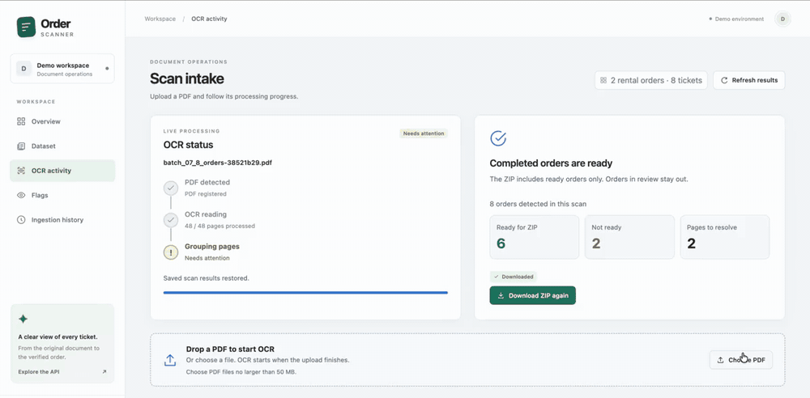
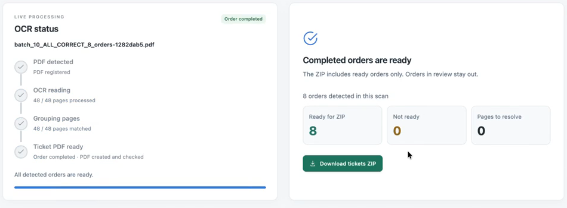
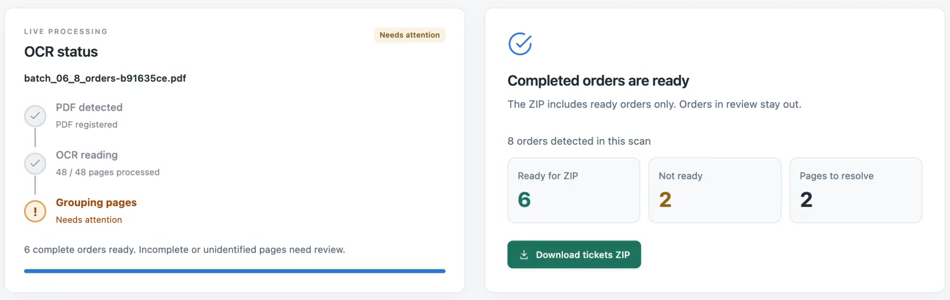
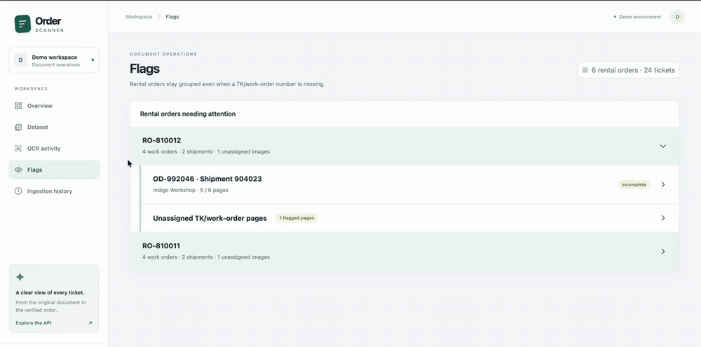

<h1> Order Scanner</h1>

**150 tickets a day: from around 5 hours of manual work to about 10 minutes.**

*Observed in the original operational workflow, including manual review: approximately 4 hours 50 minutes saved per day—a 97% reduction in processing time.*

Order Scanner automates document reading, order matching, completeness checks, and PDF assembly in one browser workspace. Uncertain page matches stay available for human review.

**Upload → Process → Review → Download** · [Watch the MP4](docs/media/order-scanner/ocr-complete.mp4)

*An edited 17-second demo using synthetic documents; waiting time is omitted. The recordings and screenshots on this page predate the current order numbering and show earlier labels. Today a rental order (`RO-`) creates work orders (`W-`) and a sales order (`SO-`) creates shipments; see [order numbering](docs/demo-workflow.md#order-numbering).*

## Why I built it

I identified an operational bottleneck: processing order documents manually took around five hours, alongside staff's other responsibilities. I designed and built Order Scanner to reduce that work and let staff focus on exceptions that need judgment.

- **Started with Google ADK** to explore an agent-based solution.
- **Shifted to an OCR workflow with Streamlit** for document extraction and order processing.
- **Adapted the application into this public version** with FastAPI, JavaScript, SQL-backed processing, visual review, and download history.

This is a separate public copy of my original application. It uses fictional records and generated documents to protect company information; operational data and credentials are excluded. Google ADK and Streamlit belong to earlier stages and are not current dependencies.

## See the workflow

| Full scan ready | Scan with flags |
| --- | --- |
|  |  |
| **8 orders ready · 0 pages to resolve** | **6 orders ready · 2 orders in review** |

| Step | What happens |
| --- | --- |
| **Upload** | Drop a shuffled sample PDF onto Overview or OCR activity. |
| **Process** | Follow page extraction and order matching through live progress updates. |
| **Review** | Inspect flagged pages beside the target order's identifiers, customer and address. Approve compatible images for missing printed-page slots. |
| **Download** | Download complete orders as PDFs or collect ready orders from a scan in a ZIP. |

The browser has five views: **Overview**, **Dataset**, **OCR activity**, **Flags**, and **Ingestion history**. A complete order can be downloaded while other orders still need review.

### Review a ticket

Open Flags, compare a candidate's extracted fields and original image with the target order, then link the matching image to its missing printed-page slot. This edited excerpt shows one repaired order; another flagged order remains.

[Watch the 27-second MP4](docs/media/order-scanner/review-and-repair.mp4)

## The impact

In the original operational workflow, processing **150 tickets per day** went from around **5 hours to 10 minutes**, including manual review. That freed approximately **4 hours 50 minutes each day** for other responsibilities—a **97% reduction in processing time**.

These are my observed results from the original application. This public copy demonstrates the workflow using synthetic documents.

[Setup and technical details](docs/project-reference.md) · [Architecture](docs/architecture.md)
