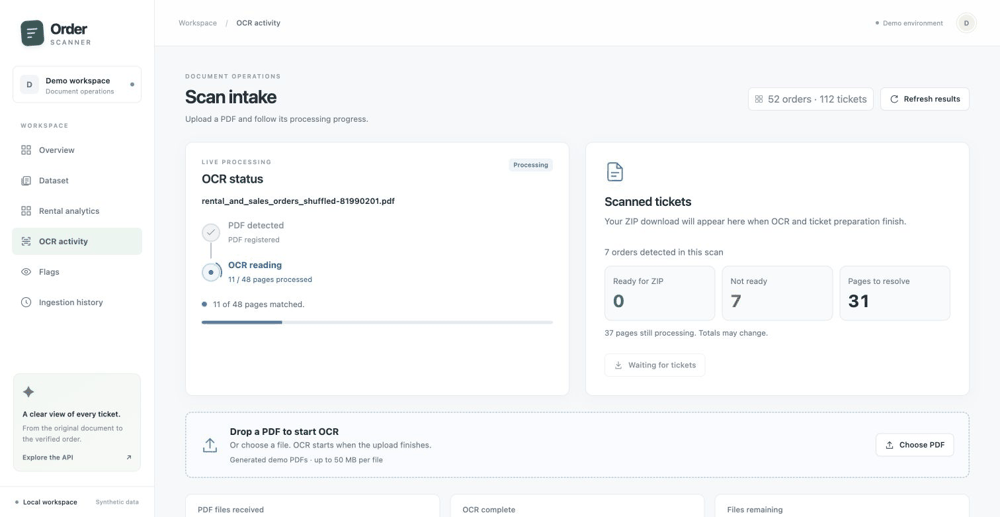

<h1> Order Scanner</h1>


**Turn shuffled rental and sales documents into verified order packets—with OCR review and rental analytics.**

I built this to reduce manual document processing. In the original workflow, **150 tickets a day went from around 5 hours to 10 minutes**, including review. These are observed operational results; this public version uses synthetic data.

## See it work



**48 pages → 6 ready documents + 2 flags → review a matching image → 7 ready + 1 remaining flag.**

[Watch the OCR repair video](docs/media/order-scanner/ocr-flag-repair-live.mp4) · [Explore the document viewer](docs/media/order-scanner/document-tracker-live.mp4)

*Real Azure OCR and browser interactions with synthetic documents. Processing is accelerated 8× and review 1.25×; recording gaps are removed. [Recording details](docs/media/order-scanner/README.md#live-ocr-and-flag-repair-november-20-2026).*

## What it does

- **Track documents:** connect rental orders to work orders and sales orders to shipments.
- **Resolve exceptions:** compare flagged images against customer, address, order and printed-page details. Preserve original scans and review decisions.
- **Download ready packets:** individual PDFs or scan ZIPs, with completeness checks and download history.
- **Analyze rentals:** billed, collected and outstanding amounts, customer/month charts, filters and CSV export.


[Watch the analytics video](docs/media/order-scanner/rental-analytics-live.mp4)

*Billing comes from an explicit ledger with fictional demo payments. Monthly charts group by invoice date. Collected amounts are not profit or recognized revenue. [Billing details](docs/rental-analytics.md).*

## Try it locally

Requires **Python 3.12–3.13, uv, macOS with Swift tools**, and **Azure Document Intelligence credentials**. Follow the [setup guide](docs/project-reference.md#run-locally), then start:

```sh
uv run --locked python -m ocr_workspace
```

Open [localhost:8700](http://127.0.0.1:8700/). The demo accepts generated synthetic PDFs; processing uploads uses billable Azure reads.

**Built with:** FastAPI, Azure Document Intelligence, SQLAlchemy, SQLite and vanilla JavaScript.

[Setup](docs/project-reference.md) · [Architecture](docs/architecture.md) · [Demo workflow](docs/demo-workflow.md) · [Rental analytics](docs/rental-analytics.md) · [Contributing](CONTRIBUTING.md)
