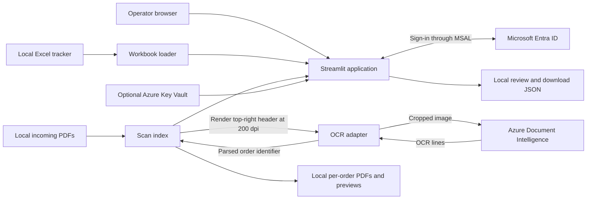

# Architecture

Status: the diagram and legacy startup flow below describe the original signed-in application. The feature branch adds the SQL data layer and separate synthetic preview described here and in the [database/ETL guide](data-pipeline.md).

## SQL data layer and synthetic preview

`storage.py` defines constrained relational tables and the initial migration for PostgreSQL/SQLite. `etl.py` extracts and validates trackers, stages source rows, quarantines invalid rows, and upserts business records. `processing.py` registers PDFs and records page-level OCR attempts/retries. `demo_app.py` reads the isolated synthetic SQL database, without sign-in or Azure calls. The original `data_loader.py` selects SQL orders when `DATABASE_URL` is set; its legacy scan/review/download state remains file backed.

See [ADR 0002](decisions/0002-relational-store-and-etl.md) for the accepted direction and remaining migration work.

## Purpose and scope

Match delivery-ticket pages to workbook orders, provide local PDFs and previews, and show order/customer status in Streamlit. Excel remains the order source of truth. The legacy workflow has no public API or background worker. The new SQL pipeline is described above.

## System context

## Component responsibilities

| Module | Responsibility | State and integrations |
| --- | --- | --- |
| `streamlit_app.py` | Sign-in, resource initialization, matching, navigation, charts, review/download state | Streamlit session state, local JSON, MSAL |
| `config.py` | Opt-in Key Vault loading; overrides corresponding environment secrets | Azure identity and Key Vault |
| `data_loader.py` | Read all workbook sheets, normalize aliases and identifiers, search orders, reload changed workbook | Local workbook and pickle cache |
| `scan_index.py` | Discover PDFs, detect changes, OCR pages, group pages by order, generate PDF/PNG artifacts | Local source PDFs, JSON index, generated artifacts |
| `ocr.py` | Azure prebuilt-read calls, optional image crop, normalize OCR lines, extract identifiers | Azure Document Intelligence |
| `utils.py` | Shared PDF naming helpers | No remote integration |

## Request and processing sequence

1. Load `.env`, optionally obtain Key Vault secrets, and initialize the page.
2. Require configured Microsoft sign-in. Missing configuration or no authenticated session stops execution before workbook loading and scan indexing. Configuration loading and output directory creation happen earlier.
3. After sign-in, clean old final-output files, initialize cached resources, and reload the workbook if needed.
4. On each Streamlit rerun, inspect incoming PDF file signatures. This is rerun-driven discovery, not a continuously running directory watcher.
5. For new/changed PDFs, render each page's top-right 50% by top 25% region at 200 dpi. Pass the already cropped image to the OCR adapter with `crop_header=False` to avoid cropping twice.
6. Parse shipment/work-order IDs; group pages, generate per-order PDFs and first-page previews, and checkpoint the index locally.
7. Compare indexed identifiers with workbook orders. Display readiness, workbook status, review state, and available downloads. A matching ticket is evidence of readiness, not proof of an external fulfillment transaction.

## Persistence and lifecycle

Workbook cache signatures include absolute path, byte size, and modified time. The UI reload check uses workbook modified time and empty-state detection. PDF folder indexing uses file size and nanosecond modified time, not content hashes. The separate single-file indexing method has a weaker cached-path shortcut.

The scan index stores source paths and zero-based page numbers. Unrecognized pages receive an `UNMATCHED_...` key. OCR exceptions are logged; there is no durable per-page retry queue. A PDF can be marked indexed despite a page-level OCR failure, so a later rerun can skip it. Force reindexing can repeat paid OCR calls.

Removing a source PDF retains indexed associations and previously generated files. This is not a deletion policy. Final files under `ADK_Agentic/output/` older than seven days are deleted after authenticated startup/reruns. `upload_ready/`, incoming scans, and caches have no equivalent automatic retention policy.

## Trust boundaries and deployment limits

Microsoft sign-in establishes one shared application access level. Session identity is stored in Streamlit state. Validate redirect/session behavior and access restrictions with a real tenant before deployment; the unit suite does not cover that flow.

Full local documents stay on the application host during normal folder indexing; cropped images leave for Azure. Cropping cannot guarantee absence of personal data. The OCR adapter also permits uncropped inputs. Logs can include filenames, paths, extracted identifiers, and exception details.

Local pickle caches must be trusted. JSON registries are rewritten without transactional coordination. Shared cached resources, synchronous OCR in the UI process, and file writes have no explicit cross-session/process locking. Treat the current deployment as one host and one coordinated writer; do not assume safe horizontal scaling.

## Next design decisions

Separate UI, application workflow, and integrations while retaining a single deployable application. Prioritize explicit OCR error/retry state, atomic storage, data contracts, and authentication integration tests. Introduce queues or external storage only when measured workloads and hosting requirements justify them. See the proposed ADR for migration gates.

## Code evidence

- [Startup and UI](../ADK_Agentic/streamlit_app.py)
- [Workbook loading](../ADK_Agentic/data_loader.py)
- [Indexing and cleanup](../ADK_Agentic/scan_index.py)
- [OCR crop and parsing](../ADK_Agentic/ocr.py)
- [Secrets](../ADK_Agentic/config.py)
