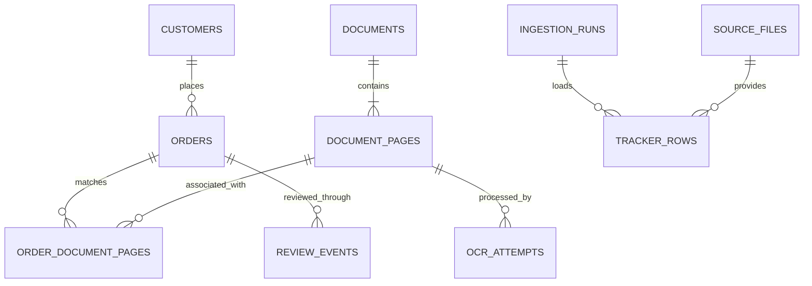
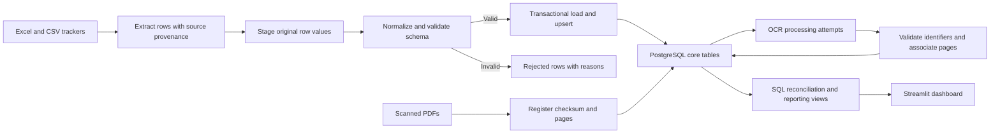

# ADR 0002: Use PostgreSQL for application data and retain Excel at the boundary

Status: Accepted direction; initial implementation on feature branch

Date: 2026-11-06

Decider: Repository owner

## Context

The current application reads Excel directly and stores OCR associations and workflow flags in JSON/pickle files. The generated demo includes 120 distinct tickets and 1,050 pages across three datasets, each with a corresponding tracker. The feature branch now adds the initial adapter, migration, ETL loader, and synthetic preview.

The portfolio should demonstrate a working document-processing and data-engineering workflow. A database contributes useful behavior when it provides validated relationships, repeatable ingestion, queryable processing history, and reliable updates. The dataset size alone does not require a database.

## Proposed decision

Use PostgreSQL as the application store. Keep Excel/CSV as supported import/export formats. Leave PDFs in managed local storage initially; store document identifiers, checksums, and relative storage references in the database rather than PDF binary data.

Maintain one application deployment with clear source, transformation, storage, and presentation boundaries. Do not introduce a distributed orchestrator or separate services before processing and deployment requirements justify them.

## Options considered

| Option | Advantages | Costs and limits |
| --- | --- | --- |
| Excel with local JSON | Existing workflow, few setup steps | Limited cross-record constraints; file-level updates; weak processing history |
| SQLite | Lightweight local SQL and transactions; convenient offline setup | Embedded database with limited concurrent write capacity; remote/shared use requires care |
| PostgreSQL | Explicit relational constraints, transactional updates, SQL reporting, shared application storage | Requires a database service, credentials, migrations, backup, and deployment configuration |

PostgreSQL is the proposed portfolio target because it supports the intended shared application and makes schema/ETL work independently reviewable. SQLite could later support a local demonstration adapter if there is a clear need; implementing two stores immediately would add maintenance before the PostgreSQL workflow is complete.

## Proposed schemas and entities

| Schema | Tables | Responsibility |
| --- | --- | --- |
| `staging` | `source_files`, `tracker_rows`, `rejected_rows` | Source provenance, raw imported rows, validation failures |
| `core` | `customers`, `orders`, `documents`, `document_pages`, `order_document_pages` | Validated business entities and document associations |
| `ops` | `ingestion_runs`, `ocr_attempts`, `review_events` | Load outcomes, OCR attempts/retries, review history |

These logical tables now exist in the initial SQLAlchemy model. The implementation and remaining limits are documented in [the data-pipeline guide](../data-pipeline.md).

Use primary keys for internal identity; business order/shipment identifiers remain text with appropriate uniqueness rules. A document is identified by its content checksum; pages use a unique document/page-number pair. Foreign keys prevent orphan associations. Enforce valid processing states and positive page numbers. Keep UTC processing timestamps distinct from business order dates.

Do not treat customer display names as globally unique identities. Define a source-system key strategy before loading records. Decide whether a page may match multiple orders; model the association explicitly rather than hiding that assumption in a filename.

## Proposed ETL flow

Extraction preserves source file, sheet, row, and run identity. Transformations normalize column aliases, preserve identifier strings, parse dates, validate required fields, and report invalid rows. Loading uses transactions and stable unique keys so repeating a source does not duplicate records. Define whether a rejected row fails an entire file or allows a partial load; expose that choice in the run outcome.

OCR processing should record page-level success, no-match, or error independently of source-file registration. A failed page remains retryable without reprocessing all successful pages. Generated manifest associations are ground truth for tests and may power a clearly labeled local preview; they must not be presented as actual OCR results.

## Implementation stages and acceptance criteria

1. Establish a runnable synthetic preview, separate from live sign-in and Azure processing, with clear labels and isolated state.
2. Add migrations, constraints, and a database adapter behind the existing order-source interface. Validate setup from a clean environment.
3. Implement tracker ETL with validation reports and source/run provenance. Loading the same source twice must leave business row counts unchanged.
4. Register document checksums and page records. Add per-page OCR attempts, retries, and durable error reporting.
5. Switch dashboard queries and review state to database-backed services while keeping Excel/CSV import and export.
6. Add integration checks for rollback, duplicate ingestion, rejected rows, foreign-key enforcement, and incremental updates. Record actual measurements before writing performance claims.

## Documentation and professional language

Use the conventional term **Optical Character Recognition**. Prefer user-facing names such as **Order Reconciliation**, **Document Processing**, **Review Queue**, and **Processing History**. Document implemented behavior separately from proposals. Rename the legacy `ADK_Agentic` package only in a scoped refactor that updates imports, startup commands, tests, and documentation together.

Keep changes on feature branches with pull requests. Do not push development changes directly to `main`.

## Initial implementation status

Implemented: constrained PostgreSQL/SQLite model, initial migration, transactional partial-load ETL, source/run history, synthetic manifest registration, PDF registration, page-level OCR attempts/retry CLI, SQL order adapter, and isolated local preview. The preview is running on SQLite. PostgreSQL integration is covered by a dedicated CI service; live Azure and sign-in require owner configuration. The legacy scan/review/download interface still uses files, and no background worker has been added.

## Resume evidence

Current evidence: a Python/Streamlit OCR workflow, reproducible synthetic data generation, 120 unique tickets/1,050 generated pages, and automated verification. These are fixture sizes, not proof of live Azure throughput or extraction accuracy.

After implementation and verification, a defensible resume statement would describe the delivered ETL pipeline, PostgreSQL schema, schema validation, idempotent ingestion, OCR result tracking, and dashboard. Do not claim those components as complete until they exist and are tested. Do not invent accuracy, time-saved, throughput, or production-usage metrics.

## Sources

- [PostgreSQL constraints](https://www.postgresql.org/docs/18/ddl-constraints.html): primary, unique, foreign-key, and check constraints.
- [PostgreSQL INSERT](https://www.postgresql.org/docs/18/sql-insert.html): conflict handling for inserts/updates.
- [SQLite appropriate uses](https://sqlite.org/whentouse.html): embedded/local use and client/server concurrency trade-offs.
