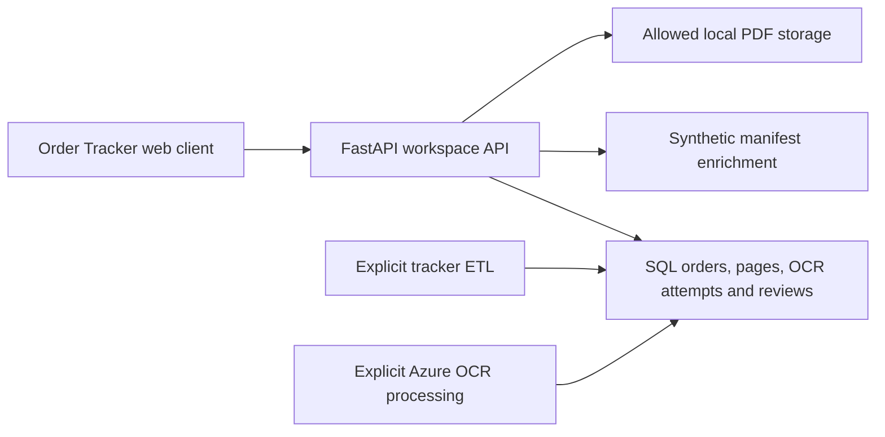

# Product UI: Order Tracker

The primary local interface is now a custom responsive web app, served by FastAPI. The original Streamlit interfaces remain as legacy tools and are no longer the primary UI.

## Run

```sh
python3 -m pip install -r requirements.txt
# Prepare generated fixtures if this is a clean checkout.
python3 scripts/prepare_demo.py
sh scripts/run_web.sh
```

Open http://127.0.0.1:8700. The runner uses the repo virtual environment or `OCR_PYTHON` when supplied. No frontend build is required. API documentation is at `/api/docs`.

The local workspace reads only known synthetic database files and refuses records marked non-synthetic. It does not load Azure credentials or make OCR requests. It uses the already persisted provider results from the validation run. This is a local product demo, not a replacement for production authentication.

## Experience

- **Overview:** real order counts, verified coverage, and recent tickets.
- **Order Tracker:** a formatted table with work order/shipment numbers, customer/delivery location, billing address, order status, OCR progress, and due date. Search and filters request API data. Pagination and CSV export use the returned records.
- **Ticket drawer:** order metadata, billing/delivery details, equipment, and the associated pages. The OCR tab shows expected and extracted identifiers with page-level results. Original batch page numbers remain visible.
- **Documents:** source batch PDFs and links to their associated work orders. File membership comes from database relationships, not filename conventions.
- **OCR activity:** actual provider attempts with identifier, document, page, outcome, and timestamp.
- **Review queue:** tickets awaiting a human check. Marking reviewed appends a SQL review event.
- **Ingestion history:** tracker runs and row counts, rendered with human-readable labels.

## Data provenance

Work-order, shipment, status, dates, and delivery location come from normalized SQL records. Billing address, contacts, equipment, and paper/copy descriptions are enriched from the matching synthetic manifest. Billing address is explicitly distinguished from delivery location. Those fields are source data; the current OCR parser extracts the shipment/work-order identifier, not addresses or line items.

Verified counts use provider page associations intersected with expected page membership, so a page linked to another valid order cannot inflate a ticket's verified coverage. Expected and actual OCR values remain visible separately.

Downloads assemble only the selected order's pages from the batch PDFs. They do not expose unrelated orders from a 60-page source file.

## API and state



- Application factory: `ADK_Agentic/web_api.py`
- Frontend: `web/index.html`, `web/styles.css`, `web/app.js`
- Startup: `scripts/run_web.sh`
- Dataset IDs map to known local databases; request parameters never select arbitrary files or database URLs.
- PDF serving is restricted to generated dataset roots. API responses use document basenames, not absolute storage paths.
- Review updates enforce same-origin requests. The server binds to localhost.
- Dynamic source values use DOM text nodes, not HTML interpolation.

## Verification

API integration tests cover SQL filters, address provenance, page previews, ticket-only PDF downloads, review persistence, wrong-order association counts, and file/source boundaries. Frontend DOM tests cover table rendering, escaped source text, pagination/search, ticket drawers, page evidence, and left navigation.

```sh
python3 -m pip install -r requirements-dev.txt
python3 -m pytest -q
cd web
npm ci
npm test
```

DOM tests do not prove visual layout or browser rendering. The browser connection was unavailable during implementation, so visual desktop/mobile inspection remains a review step. The server's HTML/JS/CSS and API responses were checked directly.

## Branching

This UI is developed on `feat/product-workspace-ui`, stacked on `feat/demo-preview-and-data-architecture`. Its PR should target that feature branch until the SQL pipeline is merged. No changes are merged into `main` automatically.

## Visual scan matching and three-PDF test

OCR activity shows registered page thumbnails, the latest attempt for each page, its returned identifier, and the associated work order. Successful matches show company/jobsite from the tracker and a ticket-only PDF download. Expected manifest links do not count as OCR evidence. Pending, running, failed, and unmatched pages remain visible. Result filters distinguish unprocessed pages from actual failures. Newest source files appear first using their local file modification time, then page order; this is not a durable scanner receipt timestamp. Up to 200 pages are returned.

The Flagged Orders card counts distinct known orders with a latest `error` or `no_match` attempt on an associated page. Expected demo membership helps identify the affected known order, but does not imply a successful match. Unassociated unknown pages still appear in the flagged scan filter and cannot yet contribute to a known-order count. Pending pages are not flagged. The total record count remains the denominator of OCR Verification.

Generate exactly three new image-only PDFs (six pages each), then stage them:

```sh
python scripts/create_demo_data.py --count 3 --min-pages 6 --max-pages 6 --start-index 121 --seed 108 --output demo_batches/intake_test_03
python scripts/prepare_intake_test.py
# Optional paid Azure test, at most 18 new calls; already attempted pages are skipped:
python scripts/prepare_intake_test.py --process
```

Select **New scan test — 3 PDFs** and open **OCR activity**. Refresh results to see attempts committed by the separate OCR command. The UI does not start cloud processing or watch folders. This test uses an isolated `demo_runtime/intake_test.sqlite`; it does not alter earlier validation evidence. The 2026-11-08 local live run returned 18 successful matches across all three PDFs. This measures identifier matching on synthetic pages, not extraction accuracy for every field.

The current forms have Work Order and Shipment/SO numbers, not a distinct rental agreement number. The UI labels a separate rental agreement number as not recorded. Company/jobsite are resolved from the tracker after matching; the header OCR does not extract them.
