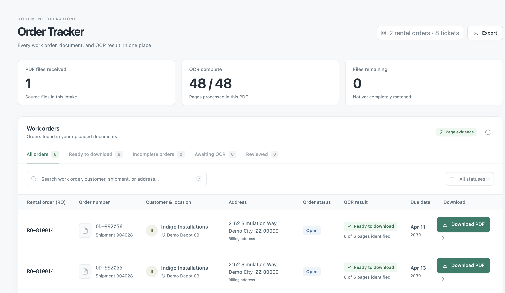
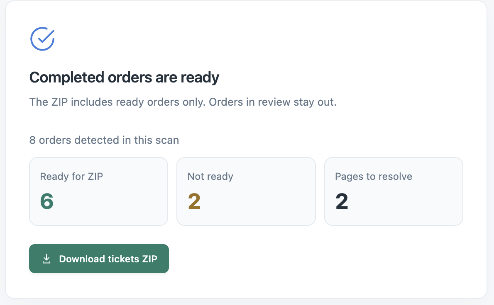
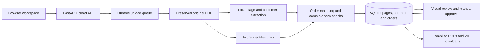

# Project reference

Setup, technical details, and additional output examples for [Order Scanner](../README.md).

### Output: organized order packets

After review, download the ready orders as a ZIP. The app records the download and offers **Download again**. Extracted files are organized into rental-order folders containing compiled order PDFs.


[Watch the ZIP download MP4](media/order-scanner/zip-download.mp4)

| Rental-order folders | Compiled order PDFs |
| --- | --- |
|  |  |

<details>
<summary>More screenshots: order tracker and ZIP readiness</summary>





</details>

### A reproducible demo

After setup, upload `Scans/incomming_scan/batch_01_8_orders.pdf`.

- It contains **48 shuffled pages across 8 work orders, 2 rental orders and 4 shipments**.
- Six orders have normally positioned identifiers. Two each have one order number shifted below the fixed Azure crop, while the full original image still contains it.
- The intended result is six automatically complete orders and two requiring visual review. Actual provider readings determine the result; these are test expectations, not an accuracy measurement.
- Open **Flags → Fix pages**, compare the candidate image with its target, and approve the correct printed page. Then download the completed packet.

The generator can produce eight batches totaling **64 work orders and 384 pages**. These are synthetic fixture sizes, not production-volume claims. For a separate sample with all identifiers inside the crop:

```sh
uv run --locked python scripts/create_rental_hierarchy_sample.py --clean --batch-number 10
```

This adds `batch_10_ALL_CORRECT_8_orders.pdf` without submitting it or preloading orders. See the [demo workflow](demo-workflow.md) for sample details, identifier definitions and review behavior.

## How it works



Local extraction reads customer, address and printed-page details. Azure Document Intelligence reads the right half of the top quarter of each page. Order, rental-order and shipment identifiers stay separate; a matching shipment alone cannot verify a work-order page.

The frontend uses HTML, CSS and JavaScript. FastAPI serves the UI and API, and server-sent events deliver processing progress. SQLAlchemy manages the local SQLite schema and migrations. Separate ingestion tools support PostgreSQL and workbook imports.

### Engineering decisions

- **Recoverable processing:** durable queue markers retain pending submissions across restarts. A process lock coordinates the local worker, and persisted attempts prevent automatic repeat calls for already attempted pages. Failed attempts remain visible for deliberate recovery.
- **Preserved evidence:** database pages reference checksum-verified original uploads. Manual approval adds a separate record instead of replacing the original OCR result.
- **Explicit review rules:** known identity and printed-page conflicts block assignment on both the server and client. Unreadable identity or shipment differences require acknowledgment.
- **Completeness before download:** each expected printed-page slot must be accounted for without duplicates. ZIP downloads include ready orders from the selected scan.
- **Versioned download history:** PDF and ZIP downloads record the served document version. Previews do not mark orders downloaded; earlier receipts remain when source pages change.

## Run locally

### Prerequisites

- Python **3.12 or 3.13** and `uv`.
- **macOS with Swift command-line tools** for raster-page extraction through Vision.
- An **Azure Document Intelligence** endpoint and key for OCR processing.
- Node.js and npm only if running frontend checks; the static UI needs no build step to launch.

From the repository root:

```sh
uv sync --locked --all-groups
# Preserve an existing local configuration:
test -f .env || cp .env.example .env
```

Set your own credentials in `.env`:

```dotenv
AZURE_DOC_INTEL_ENDPOINT=https://YOUR-RESOURCE.cognitiveservices.azure.com/
AZURE_DOC_INTEL_KEY=YOUR-KEY
```

Initialize storage, generate samples and start the server:

```sh
uv run --locked python scripts/prepare_workspace.py
uv run --locked python scripts/create_rental_hierarchy_sample.py --all-batches
sh scripts/run_web.sh
```

Open **http://127.0.0.1:8700/#/overview** and choose a PDF from `Scans/incomming_scan/`. That folder retains its existing spelling for compatibility. Upload through the browser; copying a PDF into the folder does not submit it.

Initialization migrates existing storage without clearing it. Sample refresh backs up and replaces named templates while preserving submitted originals and workflow history. Generating samples and browsing existing results make no Azure calls. **Processing uploads calls Azure and may incur charges.**

## Validation

The latest local run passed **137 Python tests** and **29 frontend tests**, with **8 Python tests skipped**. Tests cover upload boundaries, page matching, review conflicts, PDF readiness, download marks and reset protection. Azure responses are mocked. Optional PostgreSQL integration tests require a disposable `TEST_DATABASE_URL`.

Run the checks from a feature branch:

```sh
uv run --locked ruff check ocr_workspace scripts tests
uv run --locked pytest -q
cd web
npm ci
npm run check
npm test
```

Automated results do not establish live Azure connectivity, OCR accuracy on unfamiliar documents, or production readiness.

## Project structure

| Path | Purpose |
| --- | --- |
| `ocr_workspace/` | API, OCR, matching, review, persistence and compatibility utilities |
| `web/` | Browser interface and frontend tests |
| `scripts/` | Startup, sample generation, ingestion and maintenance tools |
| `tests/` | Python regression tests and fixtures |
| `database/` | PostgreSQL migration references |
| `docs/` | Architecture, configuration, operations and workflow guides |
| `Scans/` | Local samples, preserved uploads, flagged scans and compiled PDFs |
| `demo_runtime/` | Local SQLite databases, worker lock and compiled extraction helper |

Credentials, local scans, workbooks, generated datasets and runtime databases are excluded from Git. The destructive `scripts/rebuild_scan_dataset.py` tool requires `--confirm-reset`; it deletes local scans and runtime history. Normal startup does not invoke it.

## Current scope

The application runs on localhost and accepts generated synthetic PDFs verified against a checksum allowlist. It has no production authentication or unrestricted private-document ingestion. Raster extraction currently depends on macOS; unfamiliar document layouts need field mappings and validation. Distributed worker coordination is outside the current scope.

The crop is a fixed region, not a detector for personal information. Current samples keep customer details and signatures outside it. Reported signature evidence does not authenticate a signature.

## Documentation

- [Architecture and components](architecture.md)
- [Demo workflow, sample cases and persistence](demo-workflow.md)
- [Detailed UI and review behavior](product-ui.md)
- [Configuration](configuration.md)
- [Operations and recovery](operations.md)
- [Database and ingestion tools](data-pipeline.md)

[Earlier recordings](walkthroughs.md) and [historical Azure validation](ocr-validation-results.md) describe previous workflows and fixtures. They do not demonstrate the current interface or measure the current sample set.
