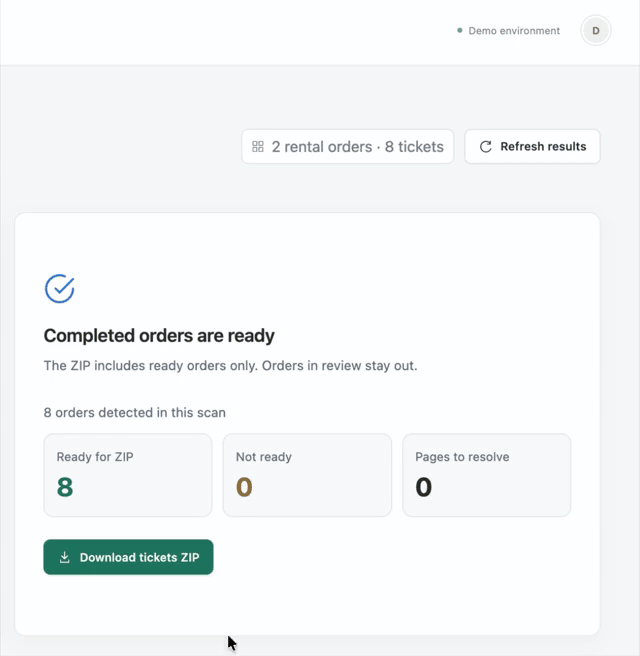
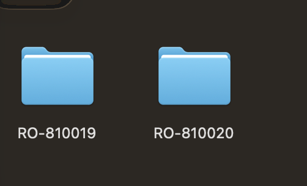
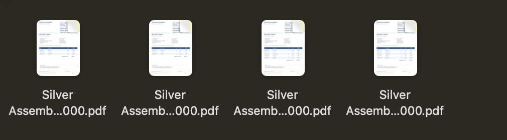
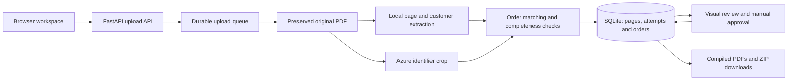

# Project reference

Setup, technical details, and additional output examples for [Order Scanner](../README.md).

### Output: organized order packets

After review, download the ready orders as a ZIP. The app records the download and offers **Download again**. In the ZIP, each document sits in a folder named after its order: a rental order's folder holds its work orders and a sales order's folder holds its shipments. The recording and screenshots below predate the current [order numbering](demo-workflow.md#order-numbering) and show earlier labels and an earlier folder layout.



[Watch the ZIP download MP4](media/order-scanner/zip-download.mp4)

| Rental-order folders | Compiled order PDFs |
| --- | --- |
|  |  |

<details>
<summary>More screenshots: order tracker and ZIP readiness</summary>


</details>

### A reproducible demo

After setup, upload `Scans/incomming_scan/batch_01_8_orders.pdf`.

- It contains **48 shuffled pages across 8 six-page documents**: 2 rental orders (`RO-`) with 3 work orders (`W-`) each, and 2 sales orders (`SO-`) with one shipment each.
- Six documents have normally positioned identifiers. Two work orders each have one work-order line shifted below the fixed Azure crop, while the full original image still contains it.
- The intended result is six automatically complete documents and two work orders requiring visual review. Actual provider readings determine the result; these are test expectations, not an accuracy measurement.
- Open **Flags → Fix pages**, compare the candidate image with its target, and approve the correct printed page. Then download the completed packet.

The generator can produce eight batches totaling **64 documents and 384 pages**: 48 work orders under 16 rental orders, and 16 shipments under 16 sales orders. These are synthetic fixture sizes, not production-volume claims. For a separate sample with all identifiers inside the crop:

```sh
uv run --locked python scripts/create_rental_hierarchy_sample.py --clean --batch-number 10
```

This adds `batch_10_ALL_CORRECT_8_orders.pdf` without submitting it or preloading orders. See the [demo workflow](demo-workflow.md) for sample details, identifier definitions and review behavior.

For larger scans in the owner's page counts (three-page work orders, one-page shipments):

```sh
uv run --locked python scripts/create_order_samples.py
```

This writes 300 orders (150 rental, 150 sales) as six shuffled PDFs of 155 to 240 pages, plus `orders.csv` and `manifest.json`, to `demo_data/order_samples/`. Add `--register` to copy the PDFs into `Scans/incomming_scan/` and allow them to be uploaded. **Every uploaded page is one billable Azure read, and the six files hold 1,261 pages.** Upload one file first, and set `OCR_MAX_PAGES_PER_FILE` to cap a file. Details are in [300-order sample scans](demo-data.md#300-order-sample-scans).

### Order numbering

```text
Shared count for orders: 1, 2, 3, ...

RENTAL                                 SALE
RO-0000002  (rental order)             SO-0000001  (sales order)
 ├─ W-0000001   work order, 3 pages     ├─ Shipment 00001   1 page
 └─ W-0000002   work order, 3 pages     ├─ Shipment 00002   1 page
                                        └─ Shipment 00003   1 page
```

Rental orders and sales orders are the parent orders and share one count. A rental order creates work orders; a sales order creates shipments. A page prints its order and its own document. The tracker leads with **Order**, **Work order** (which holds the shipment for a sale) and **Address**. The full rules are in the [demo workflow](demo-workflow.md#order-numbering).

## How it works



Local extraction reads customer, address and printed-page details. Azure Document Intelligence reads the right half of the top quarter of each page. A page is identified by its own document: the work order (`W-0000001`) on a rental page, or the shipment (`Shipment 00001`) on a sales page. A readable order number (`RO-` or `SO-`) alone does not verify a page; that page is kept under its order and flagged for review.

The frontend uses HTML, CSS and JavaScript. FastAPI serves the UI and API, and server-sent events deliver processing progress. SQLAlchemy manages the local SQLite schema and migrations. Separate ingestion tools support PostgreSQL and workbook imports.

### Engineering decisions

- **Recoverable processing:** durable queue markers retain pending submissions across restarts. A process lock coordinates the local worker, and persisted attempts prevent automatic repeat calls for already attempted pages. Failed attempts remain visible for deliberate recovery.
- **Preserved evidence:** database pages reference checksum-verified original uploads. Manual approval adds a separate record instead of replacing the original OCR result.
- **Explicit review rules:** known identity and printed-page conflicts block assignment on both the server and client. A page whose identity could not be read, or whose Azure reading differs from the target, requires explicit acknowledgment.
- **Completeness before download:** each expected printed-page slot must be accounted for without duplicates. ZIP downloads include ready orders from the selected scan.
- **Versioned download history:** PDF and ZIP downloads record the served document version. Previews do not mark orders downloaded; earlier receipts remain when source pages change.

## Run locally

### Prerequisites

- Python **3.12 or 3.13** and `uv`.
- **macOS with Swift command-line tools** for raster-page extraction through Vision.
- An **Azure Document Intelligence** endpoint and key for OCR processing.
- Node.js and npm only if running frontend checks; the static UI needs no build step to launch.

From the repository root:

```sh
# Preserve an existing local configuration:
test -f .env || cp .env.example .env
```

Set your own credentials in `.env`:

```dotenv
AZURE_DOC_INTEL_ENDPOINT=https://YOUR-RESOURCE.cognitiveservices.azure.com/
AZURE_DOC_INTEL_KEY=YOUR-KEY
```

Start the app with one command. uv installs the locked Python dependencies and the app initializes storage if needed:

```sh
uv run --locked python -m ocr_workspace
```

For a fresh checkout, generate demo PDFs once in another terminal:

```sh
uv run --locked python scripts/create_rental_hierarchy_sample.py --all-batches
```

Python dependencies are declared in `pyproject.toml` and resolved in `uv.lock`. There are no separate requirements files to install. `uv sync --locked --all-groups` is available when you want to prepare the environment without starting the app. Frontend test dependencies remain in `web/package.json` and `web/package-lock.json`.

Open **http://127.0.0.1:8700/#/overview** and choose a PDF from `Scans/incomming_scan/`. That folder retains its existing spelling for compatibility. Upload through the browser; copying a PDF into the folder does not submit it.

Initialization migrates existing storage without clearing it. Sample refresh backs up and replaces named templates while preserving submitted originals and workflow history. Generating samples and browsing existing results make no Azure calls. **Processing uploads calls Azure and may incur charges.**

## Validation

The latest local run passed **256 Python tests** and **30 frontend tests**, with **40 Python tests skipped**. Tests cover upload boundaries, page matching, review conflicts, PDF readiness, download marks and reset protection. Azure responses are mocked. Optional PostgreSQL integration tests require a disposable `TEST_DATABASE_URL`.

Run the checks from a feature branch:

```sh
uv run --locked ruff check ocr_workspace scripts tests
uv run --locked pytest -q
cd web
npm ci
npm run check
npm test
```

Automated results do not establish live Azure connectivity, OCR accuracy on unfamiliar documents, or production readiness.

## Project structure

| Path | Purpose |
| --- | --- |
| `ocr_workspace/` | API, OCR, matching, review, persistence and compatibility utilities |
| `web/` | Browser interface and frontend tests |
| `scripts/` | Startup, sample generation, ingestion and maintenance tools |
| `tests/` | Python regression tests and fixtures |
| `database/` | PostgreSQL migration references |
| `docs/` | Architecture, configuration, operations and workflow guides |
| `Scans/` | Local samples, preserved uploads, flagged scans and compiled PDFs |
| `demo_runtime/` | Local SQLite databases, worker lock and compiled extraction helper |

Credentials, local scans, workbooks, generated datasets and runtime databases are excluded from Git. The destructive `scripts/rebuild_scan_dataset.py` tool requires `--confirm-reset`; it deletes local scans and runtime history. Normal startup does not invoke it.

## Current scope

The application runs on localhost and accepts generated synthetic PDFs verified against a checksum allowlist. It has no production authentication or unrestricted private-document ingestion. Raster extraction currently depends on macOS; unfamiliar document layouts need field mappings and validation. Distributed worker coordination is outside the current scope.

The crop is a fixed region, not a detector for personal information. Current samples keep customer details and signatures outside it. Reported signature evidence does not authenticate a signature.

## Documentation

- [Architecture and components](architecture.md)
- [Demo workflow, sample cases and persistence](demo-workflow.md)
- [Detailed UI and review behavior](product-ui.md)
- [Configuration](configuration.md)
- [Operations and recovery](operations.md)
- [Database and ingestion tools](data-pipeline.md)

[Earlier recordings](walkthroughs.md) and [historical Azure validation](ocr-validation-results.md) describe previous workflows and fixtures. They do not demonstrate the current interface or measure the current sample set. The validation was recorded on an older numbering and has not been repeated on the current one.
